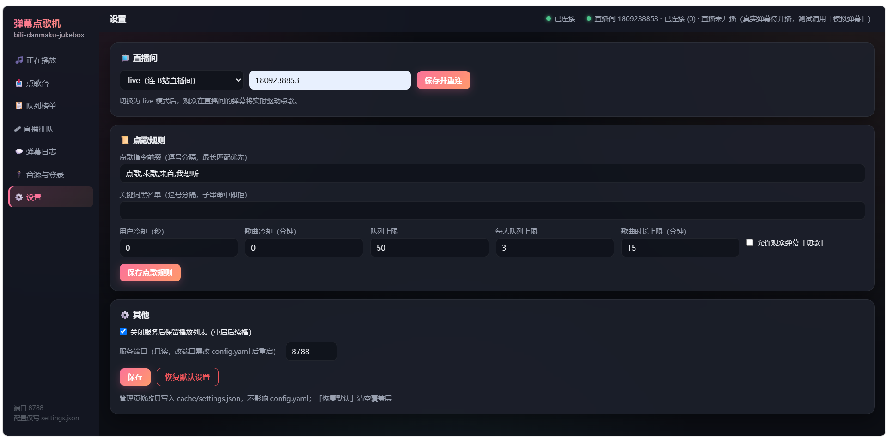
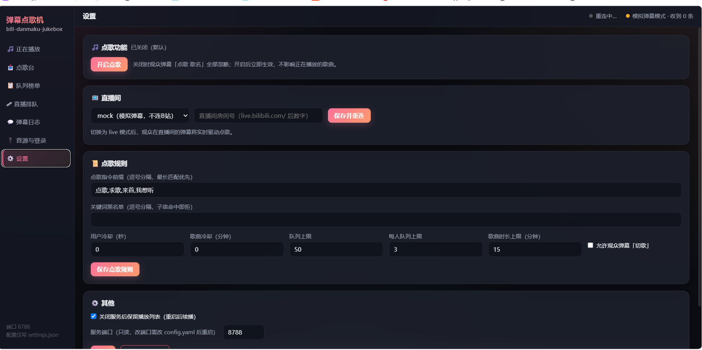
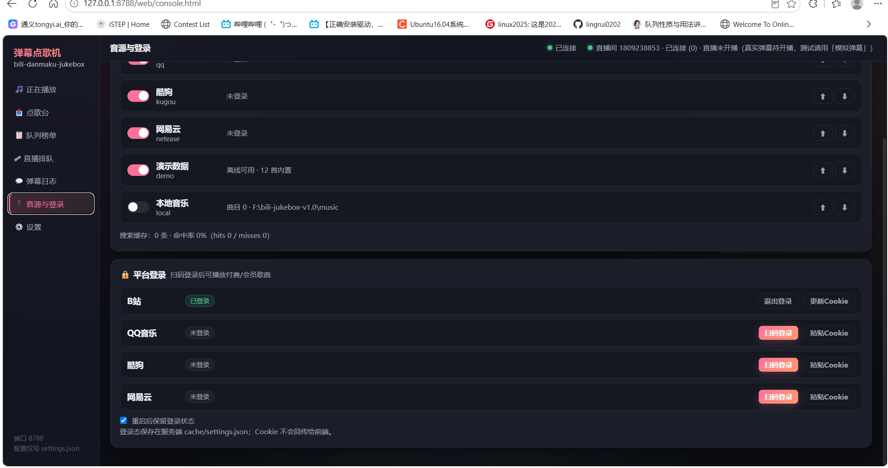
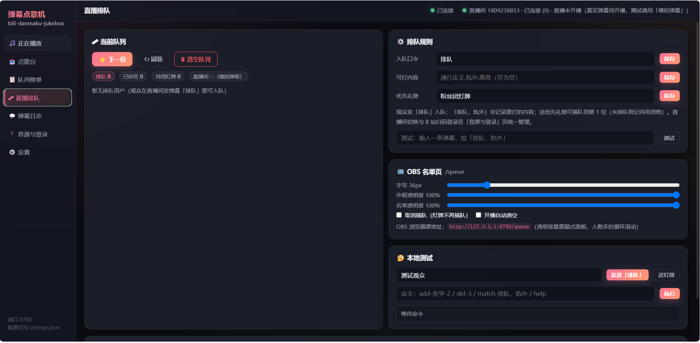
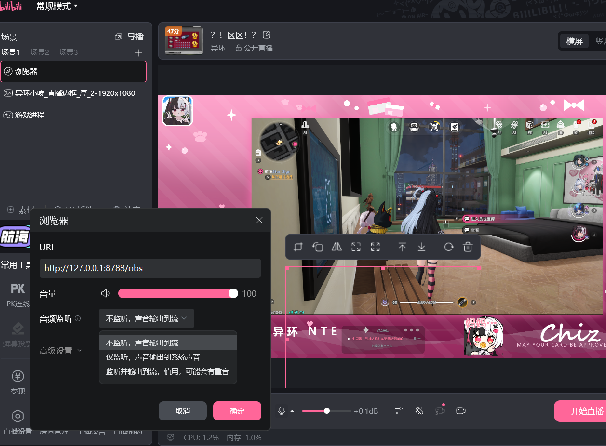

# 作者的话

首先最重要的是连接到你的直播间。

然后你需要打开点歌功能。

其次我建议至少登录b站，当然也可以不登，代价是观众会匿名显示（只显示首字母）。其他音乐源可以登录可以不登，区别在于能不能点收费歌曲。

在本页设置取消灯牌插队以及右上角设置可打内容（这次没默认设置）。

点歌后自己听不到声音是因为obs直接输出到观众端了。

---

## v1.1 补充：连不上直播间时，先看「运行日志」

左下角多了一个「运行日志」页面，程序启动、连直播间、报错都会记在里面。

- 连不上：先看右上角那行字，它会写原因（认证超时 / 查不到房间 / 未开播）；
- 想找人帮忙：在那个页面点「下载日志」，把 `jukebox.log` 发过去就行——
  里面的 Cookie、Token 已经自动打码，不用担心泄露；
- 别只在群里说「连不上」，附一份日志，问题基本一分钟就能定位。
